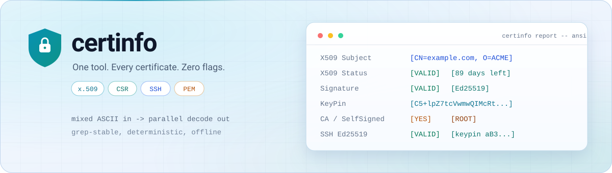
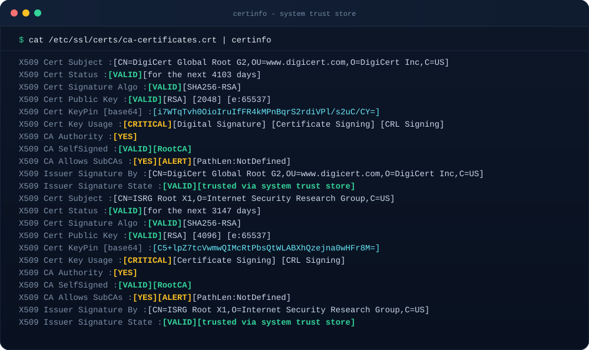
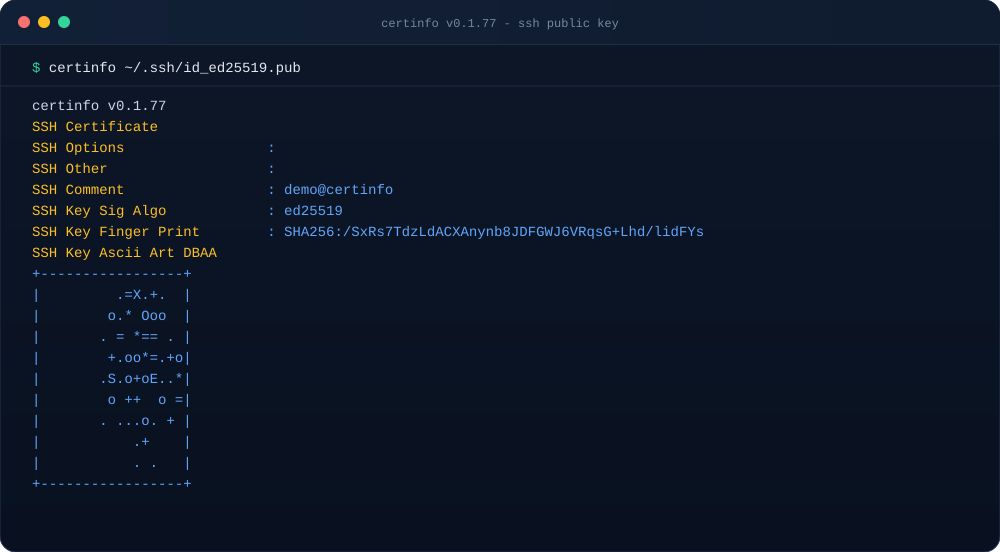

<div align="center">

<picture>
  <source media="(prefers-color-scheme: dark)" srcset="docs/hero-dark.svg">
  <source media="(prefers-color-scheme: light)" srcset="docs/hero-light.svg">
  
</picture>

# 🔐 certinfo

**One tool. Every certificate. Zero flags.**

Decode, analyze, and sanity-check x.509 certificates, CSRs, and SSH keys —
from *any* mixed ASCII input: PEM blocks, openssl dumps, concatenated trust
stores, or a plain pipe.

[](https://pkg.go.dev/paepcke.de/certinfo)
[](https://goreportcard.com/report/paepcke.de/certinfo)
[](https://github.com/paepckehh/certinfo/actions/workflows/golang.yml)
[](https://github.com/paepckehh/certinfo/blob/master/LICENSE)
[](https://github.com/paepckehh/certinfo/releases/latest)
<br>[](https://search.nixos.org/packages?channel=unstable&show=certinfo-go&from=0&size=50&sort=relevance&type=packages&query=certinfo-go)

`go run paepcke.de/certinfo/cmd/certinfo@latest`

</div>

---

## 💡 Why

Tired of guessing the right combination of `openssl x509 -text -noout -in ...`
incantations, juggling `certutil`, or squinting at raw PEM dumps?

`certinfo` just **works**: point it at *anything* — a single cert, a messy
concatenated truststore, an openssl debug dump, an SSH authorized_keys file —
and it figures out what it is, decodes everything it finds, and prints a clean,
grep-able, colorized report.

- ✨ **Zero flags, zero config** — behavior is controlled by a handful of env vars
- 🧹 **Eat anything** — mixed, multipart, noisy, or concatenated PEM? All decoded, in parallel
- 🔑 **Full key coverage** — x.509 certs, CSRs, SSH keys & certificates, public/private keys
- 🧠 **Smart analysis** — validity windows, CA/self-signed state, key usage, path length, chain trust via system store, keypins
- 🎨 **5 output styles** — ANSI color console, plain text, Markdown, HTML, clean re-encoded PEM
- 🪶 **100% pure Go** — `CGO_ENABLED=0`, tiny dependency tree, static binaries everywhere
- 🔌 **App *and* library** — clean Go API ([api.go](https://pkg.go.dev/paepcke.de/certinfo))
- 🐧 **Grep-friendly** — stable, aligned, machine-parseable output (`NO_COLOR=true`)
- 👯 **Sibling projects** — same look & feel as [`tlsinfo`](https://paepcke.de/tlsinfo/) and [`dnsinfo`](https://paepcke.de/dnsinfo/)

## 🚀 Install

**Go** (any platform with a Go toolchain):

```shell
go install paepcke.de/certinfo/cmd/certinfo@latest
```

**No toolchain? Run it straight away:**

```shell
go run paepcke.de/certinfo/cmd/certinfo@latest cert.pem
```

**Pre-built binaries** (linux/freebsd/darwin/windows, amd64+arm64):

→ [github.com/paepckehh/certinfo/releases/latest](https://github.com/paepckehh/certinfo/releases/latest)

**NixOS / nix:**

```shell
nix-shell -p certinfo-go
```

```nix
environment.systemPackages = [ pkgs.certinfo-go ];
```

## 🎬 Showtime

Decode the whole system trust store in one go:

```shell
cat /etc/ssl/* | certinfo
```

```text
X509 Cert Subject           : [CN=ISRG Root X1,O=Internet Security Research Group,C=US]
X509 Cert Status            : [VALID] [for the next 4554 days]
X509 Cert Signature Algo    : [VALID] [SHA256-RSA]
X509 Cert Public Key        : [VALID] [RSA] [4096] [e:65537]
X509 Cert KeyPin [base64]   : [C5+lpZ7tcVwmwQIMcRtPbsQtWLABXhQzejna0wHFr8M=]
X509 Cert Key Usage         : [CRITICAL] [Certificate Signing] [CRL Signing]
X509 CA Authority           : [YES]
X509 CA SelfSigned          : [VALID] [RootCA]
X509 CA Allows SubCAs       : [YES] [ALERT] [PathLen:NotDefined]
X509 Issuer Signature By    : [CN=ISRG Root X1,O=Internet Security Research Group,C=US]
X509 Issuer Signature State : [VALID] [trusted via system trust store]
```

One cert file? Same command. Multiple files? Just list them. Pipe preferred.

### 📸 Real world, real output

<p align="center">
  
</p>

<p align="center"><sub><b>Whole system trust store in one pipe</b> - every root decoded, pinned and trust-checked.</sub></p>

<p align="center">
  
</p>

<p align="center"><sub><b>SSH keys too</b> - type, fingerprint and the classic randomart, straight from an authorized_keys line.</sub></p>

## 🎛 Modes (env vars, not flags)

| Env var | What it does |
| :--- | :--- |
| *(none)* | Colorized summary report (ANSI) |
| `NO_COLOR=true` | Plain ASCII report — perfect for `grep` / piping |
| `VERBOSE=true` | Add the full openssl-compatible dump |
| `PEMONLY=true` | Clean re-encode only: sanitize & normalize to canonical PEM |
| `PINONLY=true` | Print just the base64 keypin (e.g. for HPKP pinning) |
| `HTML=true` | Full HTML report |

```shell
VERBOSE=true certinfo certs.txt     # deep-dive incl. openssl-style dump
NO_COLOR=true certinfo certs.txt | grep KeyPin
PINONLY=true certinfo certs.txt     # pins only
PEMONLY=true cat /etc/ssl/* | certinfo > truststore-clean.pem
HTML=true certinfo certs.txt > report.html
```

## 📦 Use it as a library

The CLI is a thin wrapper — the real logic is a clean, dependency-light Go API:

```go
package main

import (
    "fmt"
    "paepcke.de/certinfo"
)

func main() {
    // one-liner: decode any mixed ASCII input to a text report
    fmt.Println(certinfo.ReportAsText(string(pemBytes)))

    // or roll your own report
    report := certinfo.Decode(input, &certinfo.Report{
        Summary: true,
        Style:   reportstyle.StyleText(), // or StyleAnsi/HTML/Markdown
    })
    fmt.Print(report)}
```

Highlights of the public API ([godoc](https://pkg.go.dev/paepcke.de/certinfo)):

- `Decode(asciiBlock, *Report)` — universal entry point for any mixed input
- `ReportAsText` / `ReportAsAnsi` / `ReportAsMarkdown` / `ReportAsHTML` — ready-made one-liners
- `SanitizePEM(asciiBlock)` — truststore sanitizer / PEM re-encoder
- `KeyPinBase64` / `KeyPinRaw` — keypins for any `*x509.Certificate`
- `Cert`, `CertStore`, `CertStores`, `CertRequest` — cert / CSR analysis
- `SshDecode`, `SshDecodeCert`, `PublicKey`, `PrivateKey` — key material analysis

## 🧭 Roadmap

- [ ] Optional SCT log verification (online/leaky mode)

## 📚 Docs

- API reference: [pkg.go.dev/paepcke.de/certinfo](https://pkg.go.dev/paepcke.de/certinfo)
- Project home: [paepcke.de/certinfo](https://paepcke.de/certinfo/)
- Hero artwork: [dark](docs/hero-dark.svg) / [light](docs/hero-light.svg) - hand-built, dependency-free SVG dashboard (theme-aware `<picture>`)
- Screenshots: [trust store](docs/screenshot-truststore.svg) / [SSH key](docs/screenshot-ssh.svg) - terminal renderings of actual tool output
- Releases: [github.com/paepckehh/certinfo/releases](https://github.com/paepckehh/certinfo/releases)

## 🤝 Contributing

Yes, please! PRs welcome — see [CONTRIBUTING.md](CONTRIBUTING.md).

## 🛡 License

[BSD 3-Clause License](LICENSE) — see [LICENSE](https://github.com/paepckehh/certinfo/blob/master/LICENSE) for details.

## 📃 Citation

```bibtex
@misc{certinfo,
  author = {Michael Paepcke},
  title = {certinfo: tool to analyze and troubleshoot x.509 & ssh certificates, encoded keys, ... (app/lib/api)},
  year = {2022},
  publisher = {GitHub},
  journal = {GitHub repository},
  howpublished = {\url{https://paepcke.de/certinfo}}
}
```
